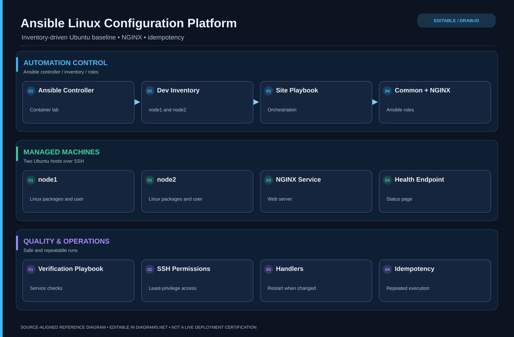

# Linux Infrastructure Automation with Ansible

<!-- drawio:architecture:start -->
### Editable architecture diagram

[Open and edit in draw.io](docs/architecture/architecture.drawio) · [View full-size SVG](docs/architecture/architecture.svg)

*This diagram is based on this repository's documented design and source code; refer to the project status above for deployed-versus-reference details.*

<!-- drawio:architecture:end -->

A reproducible Linux configuration-management lab that uses Ansible to manage multiple Ubuntu servers over SSH.

## Automation

Ansible configures:

- Linux packages
- Operations user and permissions
- SSH access
- Platform directories
- NGINX
- Server status page
- Health endpoint
- Configuration validation

## Managed Nodes

- node1
- node2

## Validation

The project includes automated configuration and verification playbooks and supports repeat runs for Ansible idempotency testing.